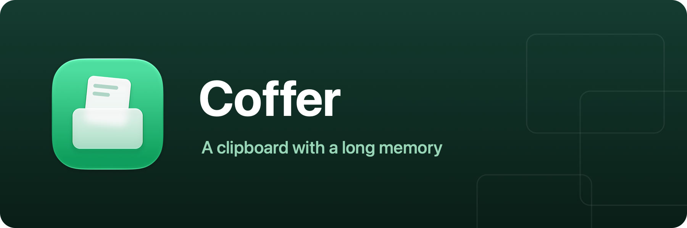

<p align="center">
  
</p>

<p align="center">
  A macOS menu bar clipboard manager, everything you copy, kept safe, searchable, and one shortcut away.<br />
  A single dependency-free Swift Package, builds with the <code>swift</code> CLI alone, no Xcode project required.
</p>

## What it does

- Watches the pasteboard and keeps a history of everything you copy (skipping entries that
  password managers mark as concealed).
- Press <kbd>⌘⌥C</kbd> anywhere to summon the history panel, <kbd>↑</kbd>/<kbd>↓</kbd> to pick
  an entry, <kbd>↩</kbd> (or double-click) to copy it back to the clipboard (<kbd>⌥↩</kbd>
  for a file's path), <kbd>Esc</kbd> to dismiss. Rows drag out as text, files, or images,
  and resting on a thumbnail opens a larger preview that drags out too. No permissions
  needed: Coffer never types or pastes for you.
  The trash button beside the search field wipes the whole history, after asking once.
- Notes which app each copy came from (the frontmost one when the copy is seen; macOS doesn't
  record the writer) and shows its icon at the row's right end.
- Keeps the history newest-first, promotes re-copied items instead of duplicating them, and
  caps the stored count, a pure model in `ClipboardHistory.swift`, tests and all.

## Building the app

```sh
./Scripts/bundle.sh
open build/Coffer.app
```

The app icon is compiled from the Icon Composer document at `Assets/AppIcon.icon` (generated by
`swift Scripts/make-assets.swift`), so on macOS 26+ the system renders it live with the Liquid
Glass treatment, including the dark, clear, and tinted variants.

## Development

```sh
swift run             # run once
./Scripts/dev.sh      # rebuild & relaunch on source changes
./Scripts/test.sh     # unit tests (equivalent to `swift test`)
```

Swift Testing needs full Xcode, Command Line Tools alone won't run it.

## Code structure

```
Sources/Coffer/
├── main.swift                   # Entry point (accessory app, no Dock icon)
├── AppDelegate.swift            # Menu bar item, hotkey + watcher wiring
├── ClipboardItem.swift          # One copy: text, image, or files
├── ClipboardHistory.swift       # Pure history model: ordering, promotion, cap, search (tested)
├── ClipboardStore.swift         # App-side store: entries (item + source app), change notifications
├── HistoryPersistence.swift     # The history on disk across launches
├── PasteboardWatcher.swift      # changeCount polling, concealed-type filtering, source app
├── HotKeyCenter.swift           # Carbon RegisterEventHotKey wrapper (⌘⌥C)
├── HistoryPanelController.swift # The floating history palette
├── ThumbnailPreview.swift       # The larger preview popover beside a row
├── ItemDrag.swift               # What a row or preview carries when dragged out
├── SettingsWindow.swift         # Settings (SwiftUI grouped form)
├── AppPreferences.swift         # UserDefaults-backed preferences
├── OnboardingWindow.swift       # First-run welcome
├── Localization.swift           # Korean strings, resolved without Bundle.module
├── UpdaterController.swift      # Sparkle updates
└── TranslocationHealer.swift    # Moves a quarantined copy out of App Translocation
```

## Roadmap

- **App exclusions**: never record copies from chosen apps.
- **Shortcut**: a recordable shortcut for the history panel.

## License

MIT, see [LICENSE](LICENSE). Bundled third-party software and its licenses are listed in [THIRD-PARTY-NOTICES.md](THIRD-PARTY-NOTICES.md).

Inspired by [Maccy](https://github.com/p0deje/Maccy). No code is shared.
